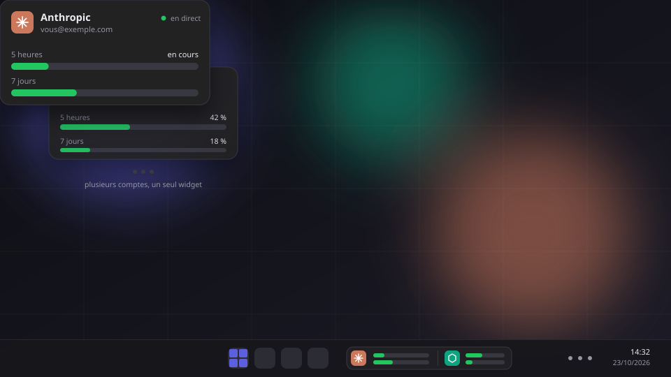

  

# CC Display Companion

**Gardez un oeil sur votre usage Claude et Codex, sans ouvrir un seul dashboard.**

CC Display Companion est une app Windows qui affiche, dans un petit widget toujours visible, ce qu'il vous reste sur vos comptes **Anthropic (Claude)** et **OpenAI (Codex / ChatGPT)** : la fenêtre de 5 heures, celle de 7 jours, et le moment où elles se réinitialisent.

## Ce que ça fait

- **Un widget que vous placez où vous voulez.** Au-dessus de vos fenêtres, dans un coin de l'écran, ou rangé à côté de la barre des tâches de Windows 11. Il se verrouille, s'aimante aux coins et se règle en taille, opacité et arrondis.
- **Plusieurs comptes, un seul coup d'oeil.** Ajoutez autant de comptes Claude et OpenAI que vous voulez. Le widget les fait défiler, ou les affiche ensemble en lignes, en colonnes ou en carte.
- **Les barres, comme vous les aimez.** Pourcentage, heure de réinitialisation, épaisseur, couleurs selon l'usage (vert, orange, rouge) ou aux couleurs du provider. Chaque détail se règle depuis l'onglet Widget, avec un aperçu en direct.
- **Rien à saisir.** Connectez un compte dans une fenêtre dédiée, ou laissez l'extension Chrome suivre ceux de votre navigateur. L'app ne voit jamais votre mot de passe.
- **Un boîtier en option.** Si vous avez un boîtier CC Display, l'app le détecte en USB et lui envoie vos données en direct. Sans boîtier, tout fonctionne quand même.

## Installer

1. Téléchargez `CCDisplayCompanion-Setup-<version>.exe` depuis la [dernière release](../../releases/latest).
2. Lancez-le (pas besoin des droits administrateur). Windows peut afficher « Windows a protégé votre ordinateur » : cliquez sur **Informations complémentaires**, puis **Exécuter quand même**.
3. Dans l'app, cliquez sur **Ajouter un compte** pour connecter vos comptes. Le widget apparaît dès que les premières données arrivent.

## Mises à jour

L'app vérifie elle-même les nouvelles versions publiées ici et propose de les installer : rien à retélécharger à la main. Chaque installeur est accompagné d'un fichier `.sha256` que l'app utilise pour vérifier le téléchargement avant de l'exécuter.
